# City labels on /urban-renewal/map/: proof, before and after

Measured 2026-10-26 09:25 UTC on the live page. **Local only:** nothing was deployed, nothing written to the site, no REST writes, no plugin
file touched. The "after" is the live page fetched at that moment with only its map block swapped, inside the local test
browser, for the block that `urban-map-labels.patch.php.txt` produces. During the test every non-GET request to nad-lan.co.il
was aborted and analytics and session-recording hosts were blocked, so these visits are not in the owner's statistics or
Hotjar recordings (390 before: 0 page errors, 2 blocked requests, 390 after: 0 page errors, 2 blocked requests, 1280 before: 0 page errors, 2 blocked requests, 1280 after: 0 page errors, 2 blocked requests).

Evidence classes: **code** (numbers from `proof.py`, read from the DOM and from pixels of the screenshots), **eyes** (the
screenshots below, looked at), **unverified** (listed at the end).

## What changed (labels only)

- **The label:** a circle sized by the count (area grows with the count), the count inside in white IBM Plex Mono, and the city
  name beside it in ink `#12202A` with a white halo (IBM Plex Sans Hebrew 600). Was: a brass `#9C7A3C` pill, "city · count",
  `#FAF7F1` text, 3.73:1.
- **Collision rule:** biggest counts first. Cities whose tap areas would touch share one circle with the summed count and the
  name "<biggest city> ועוד N"; a tap on it zooms to fit its cities. A name shows only where it overlaps nothing and sits clearly
  nearer its own circle than any other; otherwise it waits for a closer zoom, a hover, keyboard focus or a tap.
- **Tap targets:** 44 x 44 px on touch screens, 24 x 24 px with a mouse (WCAG 2.5.8), never overlapping.
- **Base map:** Hebrew labels (`language: "he"` and the Mapbox RTL text plugin; before, the map said Amman, Jordan, West Bank,
  Gaza Strip in English), the base map's own label for a city we already name is hidden, base-map words at 60% opacity.
- **City card** (Part B of the patch, can be left out): the same tap that loads today's complex list also opens a card with the
  count, the stage split and units on the authority map, what moved since 15.8.2026, and buttons to the tracker (set to that
  city) and to the list.
- **Fonts:** finding: the site skin forces Assistant on every `span`, `button`, `p` with `!important` (`body.nl-skin-a span`),
  so today's pills render in Assistant 900, and the page's own IBM Plex data block (`.nlur2`) also renders in Assistant on the
  live page. The patch pins IBM Plex on the labels and the card only, with scoped `!important` rules. Measured after:
  names in "IBM Plex Sans Hebrew", counts in "IBM Plex Mono".

Not changed: data, routes, REST, page text, the note under the map, the list markup, the SEO block, the data block, schemas.
`build.py`: both patch variants lint clean (`No syntax errors detected`), the text outside the map block is byte-identical, and the live page
served exactly the live-520 block (drift check: equal). Part A alone (labels without the card) was also loaded inside the
live page at 390 and 1280 px (26.10.2026, 08:40 UTC, no clicks): the same layout at country zoom (10 and 14 names, 0 overlaps,
74 of 74 counts on screen, tap targets 44 and 24 px) and no page errors.

## Before and after, by width and zoom

"In view" = cities whose point is inside the map at that zoom (of 76). "Names readable" = the whole name is visible and not
covered by another label. "Complete label" = name and its count both readable. Contrast "min" is the WCAG ratio of the
lowest label (text against its own background or halo); "pixel" is the 5th/95th percentile luminance inside each readable
name box, sampled from the 2x screenshots.

| 390 px | zoom | in view | text contrast, min (target 7:1) | pixel contrast, median | overlapping label pairs (target 0) | names readable | complete labels (name + count) | counts on screen (alone or in a group total) | cities you can tap | smallest tap target (target 44 on phones) | overlapping tap targets | names nearer another circle |
|---|---|---|---|---|---|---|---|---|---|---|---|---|
| today · country (the page's first view) | 7 | 74 | 3.73:1 | 4.2:1 | 475 | 17 (23% of view, 22% of 76) | 17 | 20 / 74 | 44 / 74 | 56.4 x 31 | 475 | - |
| **proposal** · country (the page's first view) | 7 | 74 | 16.59:1 | 16.6:1 | 0 | 10 (14% of view, 13% of 76) | 10 | 74 / 74 | 74 / 74 | 44 x 44 | 0 | 0 |
| today · central district | 9 | 36 | 3.73:1 | 3.9:1 | 66 | 19 (53% of view, 25% of 76) | 16 | 20 / 36 | 31 / 36 | 61.5 x 31 | 66 | - |
| **proposal** · central district | 9 | 36 | 16.59:1 | 16.6:1 | 0 | 13 (36% of view, 17% of 76) | 13 | 36 / 36 | 36 / 36 | 44 x 44 | 0 | 0 |
| today · Tel Aviv area | 11 | 11 | 3.73:1 | 3.7:1 | 4 | 8 (73% of view, 11% of 76) | 8 | 10 / 11 | 11 / 11 | 61.5 x 31 | 4 | - |
| **proposal** · Tel Aviv area | 11 | 11 | 16.59:1 | 16.6:1 | 0 | 8 (73% of view, 11% of 76) | 8 | 11 / 11 | 11 / 11 | 44 x 44 | 0 | 0 |

| 1280 px | zoom | in view | text contrast, min (target 7:1) | pixel contrast, median | overlapping label pairs (target 0) | names readable | complete labels (name + count) | counts on screen (alone or in a group total) | cities you can tap | smallest tap target (target 44 on phones) | overlapping tap targets | names nearer another circle |
|---|---|---|---|---|---|---|---|---|---|---|---|---|
| today · country (the page's first view) | 7 | 74 | 3.73:1 | 4.1:1 | 475 | 17 (23% of view, 22% of 76) | 17 | 20 / 74 | 44 / 74 | 56.4 x 31 | 475 | - |
| **proposal** · country (the page's first view) | 7 | 74 | 16.59:1 | 16.6:1 | 0 | 14 (19% of view, 18% of 76) | 14 | 74 / 74 | 74 / 74 | 24 x 24 | 0 | 0 |
| today · central district | 9 | 40 | 3.73:1 | 3.8:1 | 68 | 22 (55% of view, 29% of 76) | 19 | 24 / 40 | 35 / 40 | 61.5 x 31 | 68 | - |
| **proposal** · central district | 9 | 40 | 16.59:1 | 16.6:1 | 0 | 21 (52% of view, 28% of 76) | 21 | 40 / 40 | 40 / 40 | 24 x 24 | 0 | 0 |
| today · Tel Aviv area | 11 | 13 | 3.73:1 | 3.7:1 | 4 | 11 (85% of view, 14% of 76) | 11 | 12 / 13 | 13 / 13 | 61.5 x 31 | 4 | - |
| **proposal** · Tel Aviv area | 11 | 13 | 16.59:1 | 16.6:1 | 0 | 12 (92% of view, 16% of 76) | 12 | 13 / 13 | 13 / 13 | 24 x 24 | 0 | 0 |

**Where the proposal does not win:** at the two widest views it names fewer cities than today: at country zoom 14 vs
17 on a desktop and 10 vs 17 on a phone; at district zoom 13 vs 19 on a phone and
21 vs 22 on a desktop. Today's
extra names are readable only because the labels pile on top of each other (475 overlapping pairs at country zoom,
30 cities that cannot be tapped at all, 54 counts hidden). With 44 px tap targets and no overlap, a phone at
country zoom holds about ten names; the rest are inside group circles whose totals are on screen and that open with one tap.
Google Maps shows about a dozen Israeli city names at that zoom (bench/google-il-z8.png). Complete labels (name and count
together): district zoom on a desktop 21 vs 19, Tel Aviv area 12 vs 11 (desktop) and
8 vs 8 (phone).

## Clicks and use, on the live page

| width | check | today | proposal |
|---|---|---|---|
| 390 | tap a city: the complex list under the map loads (today's behaviour) | גבעתים: 8 items (lookup HTTP 200) | תל אביב יפו: 8 items (lookup HTTP 200) |
| 390 | the same tap opens the city card | none | yes, 340 x 281 px, buttons 44/44 px tall, close button 44 px |
| 390 | card button "יומן המתחמים בעיר": the tracker's city select is set and scrolled to | none | select = תל אביב יפו, in view: True, under the sticky header: False |
| 390 | tap a group ("רמת גן ועוד 22", 412 complexes, 23 cities): the map zooms to fit it | no groups today | zoom 7 → 9.27 |
| 390 | zoom-in button | 7 → 8 | 7 → 8 |
| 390 | control: one-finger swipe on page text above the map | page scrolled 235 px, map moved: False, card opened: no | page scrolled 235 px, map moved: False, card opened: no |
| 390 | one-finger swipe on the map | page scrolled 244 px, map moved: False, card opened: no | page scrolled 305 px, map moved: False, card opened: no |
| 390 | one-finger swipe that starts on a label | page scrolled 307 px, map moved: False, card opened: no | page scrolled 235 px, map moved: False, card opened: no |
| 1280 | tap a city: the complex list under the map loads (today's behaviour) | גבעתים: 8 items (lookup HTTP 200/200) | תל אביב יפו: 8 items (lookup HTTP 200/200) |
| 1280 | the same tap opens the city card | none | yes, 320 x 297 px, buttons 44/44 px tall, close button 44 px |
| 1280 | card button "יומן המתחמים בעיר": the tracker's city select is set and scrolled to | none | select = תל אביב יפו, in view: True, under the sticky header: False |
| 1280 | tap a group ("רמת גן ועוד 22", 412 complexes, 23 cities): the map zooms to fit it | no groups today | zoom 7 → 9.72 |
| 1280 | zoom-in button | 7 → 8 | 7 → 8 |
| 1280 | mouse drag on the map pans it | moved 0.87° lng | moved 0.88° lng |
| 1280 | mouse wheel over the map (no Ctrl) | page scrolled 450 px, map zoom change 0 | page scrolled 450 px, map zoom change 0 |
| 1280 | mouse wheel over a label | page scrolled 450 px, map zoom change 0 | page scrolled 450 px, map zoom change 0 |
| 1280 | keyboard: focus a city label, Enter | list loaded: 8 items | list loaded: 8 items, card opened: True, Escape closes it: True |

Today's tap handler (the 758-character listener that fills `#nlurm-list`) is kept byte for byte in both patch variants
(`build.py`: kept).

**Finding, outside the labels: the lookup limit.** `/renewal-lookup` allows 30 lookups per IP per hour
(`nadlan_ur_lookup_rate_limited`, `inc/urban-hub.php`). Past that it answers 429 and the live page prints "אין מתחמים להצגה"
("no complexes to show") for a city that does have complexes, which is an unknown shown as a zero. My repeated proof runs from
this machine reached the limit on 26.10.2026 around 08:20 UTC, so for about an hour this connection (the owner's too, if he browses
from it) got empty lists. Many Israeli phone users share one public IP through their carrier, so heavy use of the map can hit the
same wall for real visitors. Not changed here (it is not a label); worth a separate fix: a higher or per-session limit, and an
honest message on 429.

The one-finger swipe uses real touch events (CDP `Input.dispatchTouchEvent`); the control swipe on page text proves the method
scrolls at all. `cooperativeGestures` is unchanged, so two fingers (or Ctrl + wheel) still move the map, as today.
Note: `.nlurm-top` (the city search/top controls mentioned in the brief) is **not on the live page** of 1.72.529; it exists only
in an unreleased preview (`scripts/project-stage/preview_v101.py`). The patch does not touch it and adds nothing that would
collide with it.

## Screenshots

Map only, same live page, same moment: `before-<width>-<zoom>.png` and `after-<width>-<zoom>.png` for 390 and 1280 and
country / central / tlv. Also `after-390-card.png`, `after-1280-card.png` (the city card), `after-390-tracker.png`,
`after-1280-tracker.png` (the tracker after the card button) and `after-1280-state-{default,hover,pressed,selected}.png`.

| | today | proposal |
|---|---|---|
| phone, country | 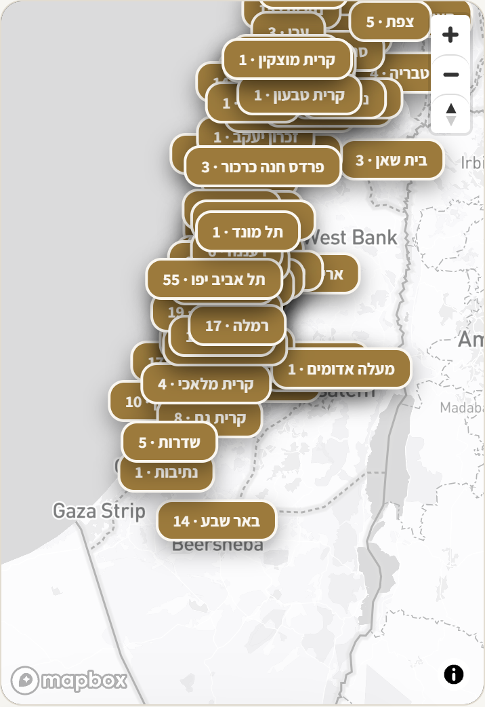 | 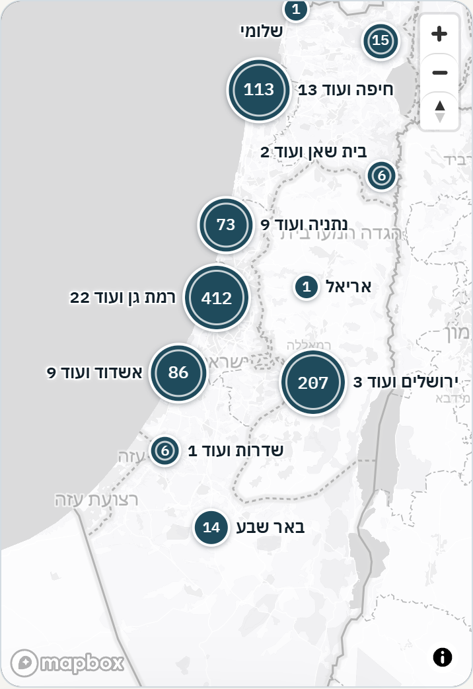 |
| phone, central | 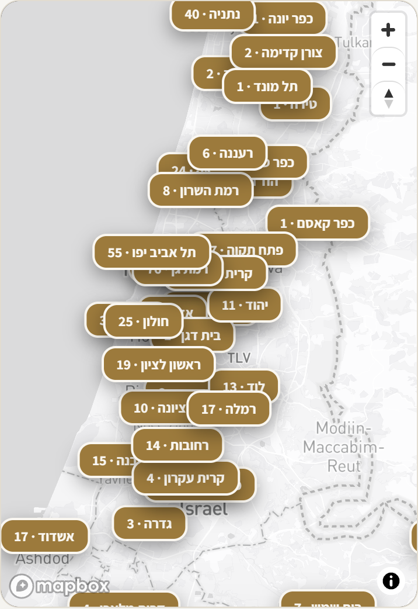 | 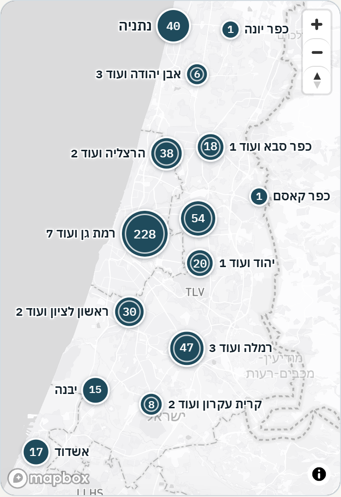 |
| phone, Tel Aviv | 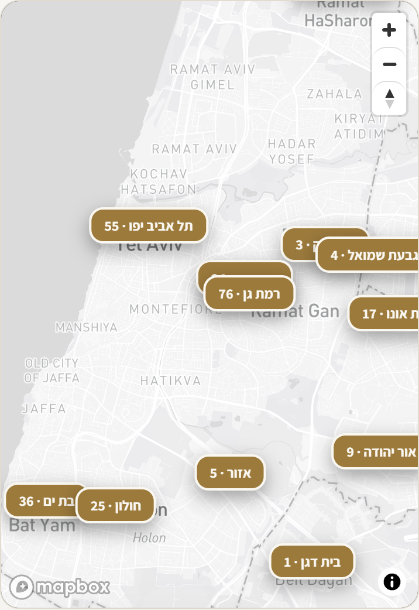 | 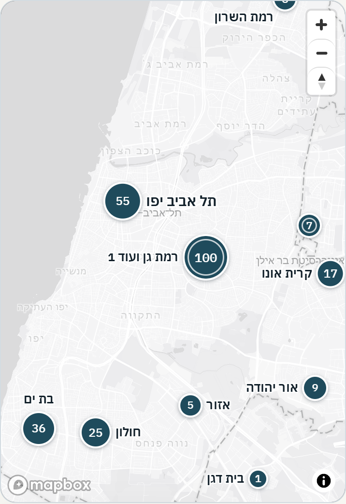 |
| desktop, country | 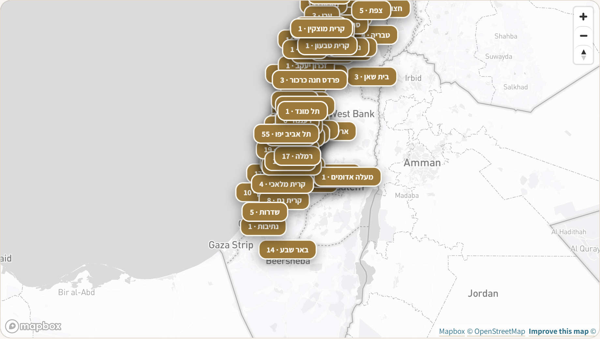 | 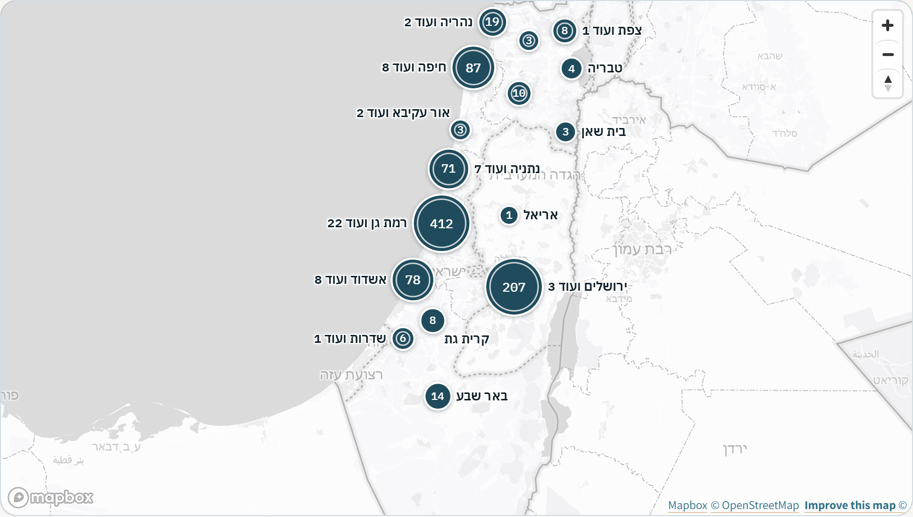 |
| desktop, central | 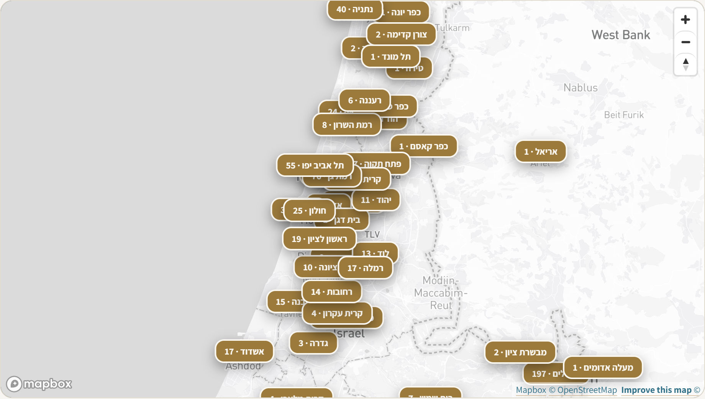 | 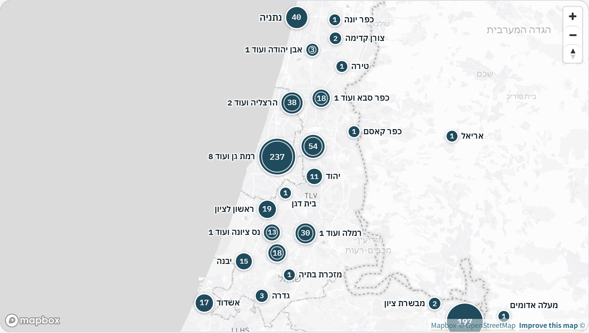 |
| desktop, Tel Aviv | 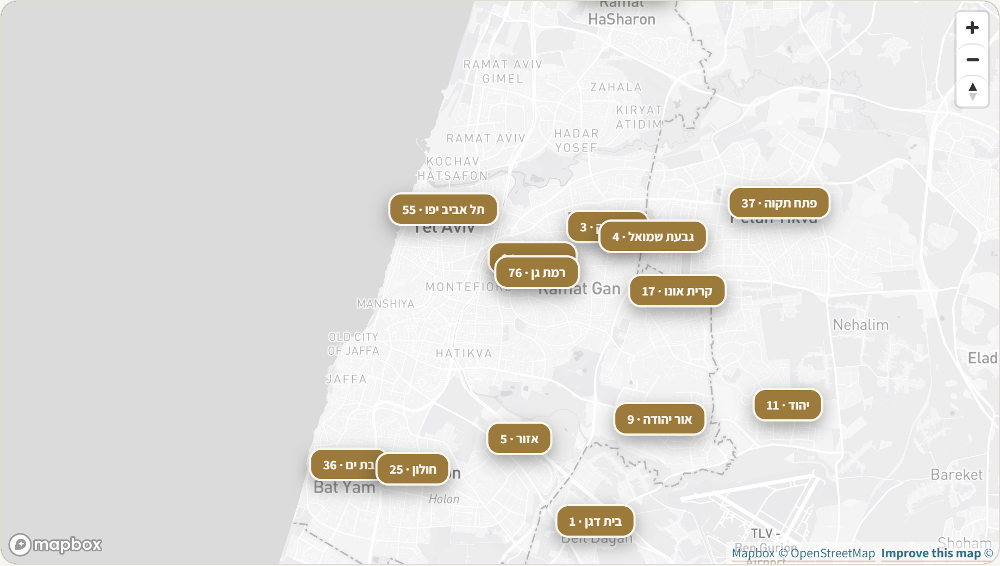 | 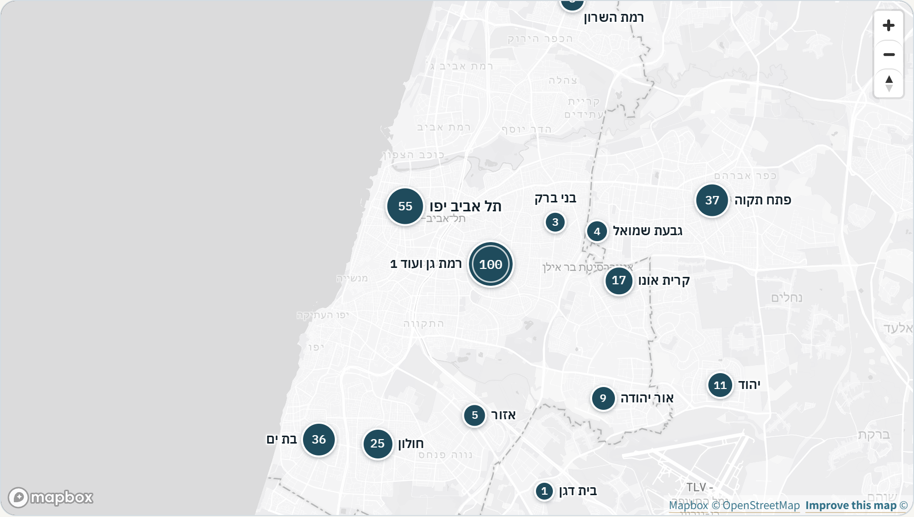 |

## Benchmark (captured 26.10.2026, Chrome via Playwright)

| capture | URL | time | how |
|---|---|---|---|
| [google-tlv-z12](bench/google-tlv-z12.png) | https://www.google.com/maps/@32.0750,34.8100,12z?hl=iw | 2026-10-26 07:23 UTC | captured headless |
| [google-il-z8](bench/google-il-z8.png) | https://www.google.com/maps/@31.75,34.95,8z?hl=iw | 2026-10-26 07:23 UTC | captured headless |
| [google-search-z12](bench/google-search-z12.png) | https://www.google.com/maps/search/%D7%A4%D7%99%D7%A0%D7%95%D7%99+%D7%91%D7%99%D7%A0%D7%95%D7%99/@32.0750,34.8100,12z?hl=iw | 2026-10-26 07:23 UTC | captured headless |
| [google-tlv-390](bench/google-tlv-390.png) | https://www.google.com/maps/@32.0750,34.8100,12z?hl=iw | 2026-10-26 07:24 UTC | captured headless |
| [mapbox-cluster](bench/mapbox-cluster.png) | https://docs.mapbox.com/mapbox-gl-js/example/cluster/ | 2026-10-26 07:24 UTC | captured headless |
| [mapbox-cluster-html](bench/mapbox-cluster-html.png) | https://docs.mapbox.com/mapbox-gl-js/example/cluster-html/ | 2026-10-26 07:24 UTC | captured headless |
| [redfin-nyc](bench/redfin-nyc.png) | https://www.redfin.com/city/30749/NY/New-York | 2026-10-26 07:28 UTC | blocked headless (HTTP 403/429), captured with a visible Chrome |
| [zillow-nyc](bench/zillow-nyc.png) | https://www.zillow.com/new-york-ny/ | 2026-10-26 07:28 UTC | blocked headless (HTTP 403/429), captured with a visible Chrome |
| [nyt-election](bench/nyt-election.png) | https://www.nytimes.com/interactive/2021/upshot/2020-election-map.html | 2026-10-26 07:28 UTC | blocked headless (HTTP 403/429), captured with a visible Chrome |
| [ft-visual-vocabulary](bench/ft-visual-vocabulary.png) | https://github.com/Financial-Times/chart-doctor/tree/main/visual-vocabulary | 2026-10-26 07:25 UTC | captured headless |
| [madlan-tlv](bench/madlan-tlv.png) | https://www.madlan.co.il/for-sale/%D7%AA%D7%9C-%D7%90%D7%91%D7%99%D7%91-%D7%99%D7%A4%D7%95-%D7%99%D7%A9%D7%A8%D7%90%D7%9C | 2026-10-26 07:29 UTC | blocked headless (HTTP 403/429), captured with a visible Chrome |
| [govmap](bench/govmap.png) | https://www.govmap.gov.il/?c=179000,663000&z=4 | 2026-10-26 07:25 UTC | captured headless |
| [gov-renewal-arcgis](bench/gov-renewal-arcgis.png) | https://moch.maps.arcgis.com/apps/webappviewer/index.html?id=d6191754d18a4fd29ee2e2ca1d040759 | 2026-10-26 07:26 UTC | captured headless |

What the best do, and what was measured on the captures:

| product | how it labels counts by place | contrast of the marker text (sampled) |
|---|---|---|
| Google Maps (he) | dot + name with a white halo, names drop out by importance as you zoom out, no overlaps; about 12 Israeli city names at zoom 8; search results as pins with halo labels, also collision-culled | dark text on halo, high |
| Mapbox cluster example | circles stepped by count (3 sizes), the count inside, a tap zooms to the expansion zoom; circles may overlap a little; no names | black on `#51BBD6` 9.4:1, on yellow 17:1 |
| Zillow | at metro zoom hundreds of overlapping dots, price pills only where they fit | white on `#99000A` 8.9:1 |
| Redfin | price pills that overlap heavily at metro zoom | white on `#01783E` 5.6:1 (AA, not AAA) |
| NYT Upshot election map | Mapbox base with sparse city names, dark text with a white halo, label hierarchy, a search box | high |
| FT Visual Vocabulary (public docs; an FT map page itself was not captured) | proportional symbol: the symbol area encodes the value | n/a |
| Madlan | teal circles sized by count with white numbers, overlapping, no names on the clusters | white on `#03AFB5` 2.7:1 (fails AA) |
| govmap | Hebrew base names, point + name, collision-culled | high |
| Government renewal map (ArcGIS, #1 for "מפת התחדשות עירונית") | green/orange dots with a black name and white halo beneath, no counts, some names collide (בת ים) | high, but no counts |

How each rule is met here:

| rule | where it comes from | measured in the proposal |
|---|---|---|
| no label collisions, biggest first | Google, govmap, Mapbox symbol placement | 0 overlapping pairs at every width and zoom |
| cluster by zoom, tap to expand | Mapbox clusters, Zillow, Redfin, Madlan | groups with the summed count; a tap zoomed 7 → 9.27 (phone) and 7 → 9.72 (desktop) |
| halo text, high contrast | Google, NYT, the government map | 16.59:1 names, 9.46:1 counts (AAA); today 3.73:1 |
| size by count | FT Visual Vocabulary, Mapbox | circle area grows with the count (radius 9 + 1.5 * sqrt(count), capped) |
| numbers in mono | survey sheets, the page's own tiles | counts in IBM Plex Mono |
| tap targets | Apple HIG 44 pt, WCAG 2.5.5 / 2.5.8 | 44 x 44 on phones, 24 x 24 with a mouse, 0 overlapping |
| one name per place, local language | Google (he), govmap | Hebrew base map, duplicates hidden |
| a name belongs to one point | cartographic practice | 0 names nearer another circle |
| counts always findable | (beyond the benchmark: none of them shows every count) | every city in view has its count on screen, alone or in a visible group total |
| a click that tells you something | (beyond the benchmark) | the card: stages, units today and after, moves, the tracker set to the city |

## Option, not done: Mapbox symbol layers

Moving the labels into Mapbox GL symbol layers (a GeoJSON source with `cluster: true`, a circle layer, a symbol layer with
`text-field` and `text-halo`) would hand collision and fading to the map engine, place names smoothly while zooming, and
cost less DOM. It is a bigger change (new layers, a click handler on the layer, keyboard access rebuilt, because markers are
buttons today), so it is offered as a next step, not done here.

## Not verified

- Real phones (iOS Safari, Android Chrome): tested only in desktop Chrome with phone emulation (390 px, touch events).
- Two-finger pan and pinch on the map (cooperative gestures are unchanged, but not exercised by the test).
- Screen readers: the buttons carry Hebrew `aria-label`s and the card has `role="dialog"`, but no screen reader was run.
- WebGL in headless Chrome ran on SwiftShader; real GPUs may differ in timing, not in layout.
- The live page's sticky WhatsApp bar covers part of the tracker in the phone screenshot; that bar is outside the labels.
- The benchmark contrast values are sampled from screenshots, not read from those sites' CSS.

## Files

| file | what |
|---|---|
| `urban-map-labels.patch.php.txt` | the patch: exact OLD/NEW blocks for the live `urban-map.php` (Part A labels, Part B card), not applied |
| `build.py`, `lib.py` | apply the patch to a copy in `out/`, `php -l`, outside-the-block check, drift check against the live page, writes `preview.html` |
| `preview.html`, `serve.py` | local preview: `python serve.py`, then `http://localhost:8765/preview.html` (the map alone) or `/live.html` (the whole live page with the block swapped) |
| `proof.py`, `proof-results.json` | the measurement and its raw results |
| `bench/bench.py`, `bench/bench.json`, `bench/*.png` | the benchmark captures |
| `ds_build.py` | builds the design-system card RenewalMapLabels |
