# Renewal map v2: proof, today vs the proposal

Measured 2026-10-26 11:36 UTC on the live page https://nad-lan.co.il/urban-renewal/map/. **Local only:** nothing was deployed, nothing written to the site, no REST writes, no plugin file touched. "Proposal" = the live page fetched at that moment with only its map block and the note under the map swapped, inside the local test browser, for what `urban-map-v2.patch.php.txt` produces (`lib2.swapped_live_page`). Every non-GET request to nad-lan.co.il was aborted and analytics and Hotjar hosts were blocked (2 requests blocked per visit), so these visits are not in the owner's statistics or recordings. Page errors: 390 before: 0, 390 after: 0, 1280 before: 0, 1280 after: 0.

Evidence classes: **code** (numbers read from the DOM and from screenshot pixels by `proof2.py`, `timing2.py`, `had605_test.py`), **eyes** (the screenshots below, looked at), **unverified** (listed at the end). Chrome headless with software WebGL; 390 px = phone emulation with touch; the sticky site header was set to static in the test browser for the element screenshots.

## What the visitor sees

- **Tags instead of gold pills.** Each city that has room gets a small white survey tag (square corners, ink text, a tick pointing at its point): the city name in IBM Plex Sans Hebrew, under it one or two facts with the numbers in IBM Plex Mono, and a 4 px strip along the bottom showing how its complexes split across the authority's stages (light = no stage, dark = in implementation). The most important cities get two facts, the next one fact, then the name alone, then a bare point that waits for the zoom. Nothing overlaps.
- **The sea as the margin.** The crowded coastal cities (Tel Aviv, Ramat Gan, Bat Yam, Netanya...) float their tags over the sea with a thin line to the city, so the first view already names and quantifies the Dan region.
- **Five chips re-label the whole map:** מתחמים (complexes and approved plans, plus the apartment price range where the Tax Authority publishes one), תכניות מאושרות, דירות חדשות (homes after building minus today), מחירי דירות (median deal prices, 3 to 5 rooms), מה זז (what changed since 15.8.2026, with the name of the complex that moved last).
- **Hover (mouse)** shows a preview: count, the stage strip with numbers, homes today and after, the price range with its quarter, what moved, and the three most advanced complexes by name. **Click or tap** opens the city in the panel: every number with its source and date, a button to "יומן המתחמים" set to the city, links to the city's price page, and every complex of the city (not only the first 8) with stage, homes, last change, a link to its page and a "ביומן" button that opens the tracker on that complex.
- **Panel:** beside the map on a wide screen, under it on a phone, listing the cities in view sorted by the chosen chip ("ערים בתצוגה: N מתוך 79"), refreshed when the map moves. **Phone:** a peek card at the bottom of the map with the facts and two 44 px buttons; one finger keeps scrolling the page. **Search:** city, complex name or plan number, spelling folded (גבעתיים finds גבעתים).
- **Base map in Hebrew**, its own name for a city that has a tag steps aside (one name per place).

## Labels: today vs the proposal (same page, same moment)

"Names readable" = the whole name is visible and not covered. "Facts readable" = fact lines on screen that are fully visible (today: the count inside a readable pill; proposal: each fact line, plus the stage strip). "Wrong point" = a tag sits nearer to another city's point than to its own. Contrast is WCAG: computed from the CSS (names / fact lines, lowest on screen) and sampled from the screenshot pixels inside each readable name (median).

| 390 px | in view | labels | names readable | facts readable | facts per label | overlapping labels | labels over a line | wrong point | contrast min, names / facts (target 7:1) | pixel contrast | smallest tap target | overlapping tap targets |
|---|---|---|---|---|---|---|---|---|---|---|---|---|
| today · country (the first view, zoom 7) | 74 | 74 | 17 | 20 | 0.27 | 475 | 0 | 0 | 3.73 / 3.73 | 4.17 | 56.4 x 31 | 475 |
| **proposal** · country (the first view, zoom 7) | 73 | 16 | 16 | 22 | 1.38 | 0 | 0 | 0 | 16.59 / 8.83 | 16.59 | 60 x 49 | 0 |
| today · central district (zoom 9) | 36 | 36 | 19 | 20 | 0.56 | 66 | 0 | 0 | 3.73 / 3.73 | 3.85 | 61.5 x 31 | 66 |
| **proposal** · central district (zoom 9) | 36 | 17 | 17 | 21 | 1.24 | 0 | 0 | 0 | 16.59 / 8.83 | 16.59 | 79 x 49 | 0 |
| today · Tel Aviv area (zoom 11) | 11 | 11 | 8 | 10 | 0.91 | 4 | 0 | 0 | 3.73 / 3.73 | 3.73 | 61.5 x 31 | 4 |
| **proposal** · Tel Aviv area (zoom 11) | 11 | 9 | 9 | 16 | 1.78 | 0 | 0 | 0 | 16.59 / 8.83 | 16.59 | 60 x 49 | 0 |

| 1280 px | in view | labels | names readable | facts readable | facts per label | overlapping labels | labels over a line | wrong point | contrast min, names / facts (target 7:1) | pixel contrast | smallest tap target | overlapping tap targets |
|---|---|---|---|---|---|---|---|---|---|---|---|---|
| today · country (the first view, zoom 7) | 74 | 74 | 17 | 20 | 0.27 | 475 | 0 | 0 | 3.73 / 3.73 | 4.14 | 56.4 x 31 | 475 |
| **proposal** · country (the first view, zoom 7) | 75 | 18 | 18 | 29 | 1.61 | 0 | 0 | 0 | 16.59 / 8.83 | 16.59 | 36 x 24 | 0 |
| today · central district (zoom 9) | 40 | 40 | 22 | 24 | 0.6 | 68 | 0 | 0 | 3.73 / 3.73 | 3.8 | 61.5 x 31 | 68 |
| **proposal** · central district (zoom 9) | 41 | 22 | 22 | 43 | 1.95 | 0 | 0 | 0 | 16.59 / 8.83 | 16.59 | 37 x 24 | 0 |
| today · Tel Aviv area (zoom 11) | 13 | 13 | 11 | 12 | 0.92 | 4 | 0 | 0 | 3.73 / 3.73 | 3.73 | 61.5 x 31 | 4 |
| **proposal** · Tel Aviv area (zoom 11) | 15 | 10 | 10 | 21 | 2.1 | 0 | 0 | 0 | 16.59 / 8.83 | 16.59 | 40 x 24 | 0 |

Phone, name-only tags: on a touch screen a name without a plate is not its own button (that would put overlapping 44 px targets on the map); a tap within 22 px of the point or on the name opens the city through the map's own tap test. Name-only tags on the phone views: country 5, central 7, tlv 2. The tap targets in the table are the tags with a plate (44 px and up on the phone, 24 px and up with a mouse, WCAG 2.5.8).

**Where the proposal does not win:** it shows fewer readable names than today in 390 px country (16 vs 17), 390 px central (17 vs 19), 1280 px tlv (10 vs 11). The extra names today are readable only because the pills pile on each other (475 and 66 overlapping pairs at the first two zooms, and many pills cannot be tapped at all). The proposal shows more facts on the same screen, with no overlap and every tag tied to its own point.

Faces measured on the proposal's tags: names `"IBM Plex Sans Hebrew", system-ui, sans-serif` 600 14px, numbers `"IBM Plex Mono", ui-monospace, monospace` (the site skin forces another face on span and button; the patch pins these with scoped `!important` rules). Token contrast on white: ink `#12202A` 16.59:1, ink2 `#3E4C58` 8.83:1, deep `#1F4B5C` 9.46:1; the chosen tag (white on deep) 9.46:1; sea `#2F6F86` 5.62:1 is used only for the stage strip, never for text.

## Every interaction, on the live page

**The list today was empty at this moment, and that is the HAD-605 bug, live:** the endpoint answered 429 to this machine (my repeated proof runs had passed its 30 calls per IP per hour; earlier runs the same day got 8 items with HTTP 200), and the live map printed "אין מתחמים להצגה" for רמת גן, a city with 80 complexes. A visitor behind a busy carrier IP gets the same. The proposal does not call the endpoint at all.

| check | today 390 | proposal 390 | today 1280 | proposal 1280 |
|---|---|---|---|---|
| tap or click a city: its complexes appear | רמת גן: 0 items (lookup HTTP [429]) | תל אביב יפו: panel opens, 57 complexes after "הציגו את כל" (every complex, 55 with a page link); 0 lookup calls | רמת גן: 0 items (lookup HTTP [429]) | תל אביב יפו: panel opens, 57 complexes; 0 lookup calls |
| the chosen tag | none | deep tag: True | none | deep tag: True |
| phone peek card | none | 158 px tall; buttons "×" 44x44, "המתחמים בעיר" 122x44, "יומן המתחמים" 115x44 | - | wide screen: the panel instead (peek: None) |
| hover preview (mouse) | - | - | none | 300 x 341 px, 3 complexes named |
| complex rows: smallest tap height | - | 44 px | - | 44 px |
| "יומן המתחמים" button: tracker set to the city, scrolled into view, clear of the sticky header | none | select = תל אביב יפו, in view True, under header False | none | select = תל אביב יפו, in view True, under header False |
| "ביומן" on one complex: the tracker opens on it | none | הדר יוסף: ok | none | הדר יוסף: ok |
| search "גניש" (a complex), pick the result | no search | גניש אור יהודה · תכנית 555-0469163 · תכנית מאושרת; city אור יהודה, row highlighted: גניש | no search | גניש אור יהודה · תכנית 555-0469163 · תכנית מאושרת; city אור יהודה, row highlighted: גניש |
| search "גבעתיים" (spelling variant) | no search | גבעתים עיר · 23 מתחמים · 8 מאושרות | no search | גבעתים עיר · 23 מתחמים · 8 מאושרות |
| phone: tap on a name-only tag | - | אשדוד -> אשדוד | - | - |
| keyboard: focus a tag, Enter, Escape | - | - | list only | focused בית דגן, panel בית דגן, Escape closes True |
| zoom-in button | 7 -> 8 | 7 -> 8 | 7 -> 8 | 7 -> 8 |
| "כל הארץ" button (fits all 79 cities) | none | zoom 12 -> 6.18 | none | zoom 12 -> 6.47 |
| mouse drag on the map pans it | - | - | pans (v1 proof: 0.87 deg) | moved 0.893 deg lng, city opened by the drag: False |
| mouse wheel over the map, no Ctrl: the page scrolls, the map does not zoom | - | - | page 450 px, zoom 0 (v1 proof) | empty spot: page 450 px, zoom 0; on a tag: page 450 px, zoom 0 |
| phone: one-finger swipe on page text above the map (control) | (v1 proof: page scrolls, map still) | page scrolled 235 px, map moved False | - | - |
| phone: one-finger swipe on the map | (v1 proof: page scrolls, map still) | page scrolled 235 px, map moved False | - | - |
| phone: one-finger swipe on a tag | (v1 proof: page scrolls, map still) | page scrolled 235 px, map moved False | - | - |
| phone: one-finger swipe on the chips row | (v1 proof: page scrolls, map still) | page scrolled 235 px, map moved False | - | - |
| phone: one-finger swipe on the peek card | (v1 proof: page scrolls, map still) | page scrolled 235 px, map moved False | - | - |

**The five chips** (desktop, first view; tags on screen / with facts; a sample):

| chip | tags | with facts | sample | first row in the panel |
|---|---|---|---|---|
| מתחמים | 18 | 12 | אריאל 1 מתחם +2,776 דירות חדשות / באר שבע 14 מתחמים · 4 מאושרות 3-5 חד׳ · 0.8-1.8 מיליון ₪ | ירושלים 215 מתחמים · 81 מאושרות |
| תכניות מאושרות | 16 | 10 | באר שבע 4 תכניות מאושרות מתוך 14 מתחמים / חדרה 8 תכניות מאושרות 1 במימוש · מתוך 20 מתחמים | ירושלים 81 תכניות מאושרות |
| דירות חדשות | 20 | 11 | אריאל +2,776 דירות אחרי הבנייה היום 378 ← 3,154 / אשקלון +9,081 דירות אחרי הבנייה היום 2,030 ← 11,111 | ירושלים +55,761 דירות אחרי הבנייה |
| מחירי דירות | 9 | 8 | באר שבע 0.8-1.8 מיליון ₪ 3-5 חד׳ · חציון עסקאות / חיפה 1.1-2.6 מיליון ₪ 3-5 חד׳ · חציון עסקאות | ירושלים 2.4-3.9 מיליון ₪ |
| מה זז | 14 | 9 | חיפה 5 נוספו · 2 עלו שלב נוסף: עליית הנוער / ירושלים 4 נוספו · 3 עלו שלב נוסף: איסלנד-מקסיקו | ירושלים 4 נוספו · 3 עלו שלב |

**Complex links in the panel** (a random 6 of the 55 Tel Aviv links, plain GET): 200 דרך השלום 87,89, תל אביב יפו: התחדשות עירונית, 172 יח״ד | נד; 200 לבנה מערב, תל אביב יפו: התחדשות עירונית, 474 יח״ד | נדלן; 200 יפתח, תל אביב יפו: התחדשות עירונית, 275 יח״ד | נדלן; 200 ברקאי, תל אביב יפו: התחדשות עירונית, 369 יח״ד | נדלן; 200 התחדשות עין גב 4-10, תל אביב יפו: התחדשות עירונית, 144 יח״ד ; 200 קהילת קנדה/שדרות ירושלים, תל אביב יפו: התחדשות עירונית, 388 .

## The lookup limit (HAD-605)

- The map no longer calls `/renewal-lookup` while the tracker file is on the page: lookup calls during the whole proof visit: today [429], proposal [] (390), today [429], proposal [] (1280). The list comes from the tracker file the page already loads, and it has every complex, where the lookup returned the first 8.
- `urban-hub-had605.patch.php.txt` (6 hunks, php -l: No syntax errors detected; round trip to the repo text: True) caches each answer 6 hours per city + query, counts only cache misses, raises the limit to 120 per IP per hour, and answers 429 with a Hebrew message and `Retry-After`. Run under php-cli with WordPress stubbed (`had605_test.py`), one IP: **today** the 31st call is refused (100 of 130 repeated city calls refused, "too many lookups"); **patched** 130 of 130 repeats answered, the first refusal comes at new query 118 (120 misses), message "הגעתם למספר הבדיקות המרבי לשעה מהחיבור הזה. נסו שוב בעוד כמה דקות.", Retry-After 600, and a cached city still answers while the IP is at its limit (200 3 matches); the count now runs for a fixed hour from the first counted call (stored as count + window start; a new query after that hour: HTTP 200), where today every counted call sets the hour again, so a steady user stays blocked until a full quiet hour.
- The live text of `inc/urban-hub.php` was not read for this proposal; the repo text equals the live read of 3.10.2026 (`docs/qa/live-read/20261003T094808Z/inc/urban-hub.php`, CRLF). Re-read the live file before applying.
- Same wrong "not found" on a 429, not patched here: the renewal wizard (`assets/urban/renewal-3d.js`, line 38); the one-line fix is in the patch header.

## Load, weight and motion

| | today 390 | proposal 390 | today 1280 | proposal 1280 |
|---|---|---|---|---|
| navigation to the first label on screen, ms (median of 3) | 2059 | 2193 | 2085 | 2457 |
| long tasks (over 50 ms) until then + 3 s | 6 | 7 | 7 | 9 |
| their total, ms | 743 | 690 | 651 | 909 |
| frame interval while the map zooms in 7 to 10, median ms | 33.4 | 34.4 | 34.5 | 34.5 |
| same, 95th percentile ms | 33.5 | 34.6 | 34.6 | 34.6 |
| frame interval while the map zooms out 10 to 7, median ms | 33.4 | 33.4 | 33.4 | 34.5 |
| same, 95th percentile ms | 33.5 | 34.2 | 33.4 | 34.6 |
| frame interval while the page scrolls past the map, median ms | 33.4 | 33.4 | 33.4 | 34.5 |
| same, 95th percentile ms | 33.4 | 33.5 | 33.5 | 34.5 |

Weight: the map block grows from 3358 bytes (1698 gzipped) to 67799 bytes (22390 gzipped): + 20.2 KB on the wire, inline in the page. New requests: the Mapbox RTL text plugin for the Hebrew base map (`mapbox-gl-rtl-text` v0.3.0; the test browser counted 3 fetches because Playwright routing turns the HTTP cache off; a normal browser fetches it once). The tracker file is the one the page already loads for "יומן המתחמים", asked again with `cache: force-cache` (the test browser counted 2 fetches for the same reason). The PHP function prints 6244 bytes of JSON (centroids + price medians) into the script; no new request.

Software WebGL makes every number here slower than a real phone; the comparison is what counts, and real devices were not measured.

## Build checks

- `build2.py`: target md5 3864aca919d7e07fed60e49c606e74af (ok: True); 6 hunks apply once each; php -l: No syntax errors detected; reverting the hunks gives back the live text byte for byte: True; the live page serves exactly the live-520 map block (True) and note (True); `node --check` on the exact script: ok; banned words in visible strings: none; long dashes: 0.
- The new PHP function ran under php-cli: 24 price cities, 82 centroids (ערד added), pulled date 13.7.2026, price file 20.8.2026.
- Data: the tracker and price files on the live site are byte-identical to the repo copies the proposal read (`cache/fetch-report.json`).

## Side by side with the competitors (details and captures: bench/BENCH.md)

| | Madlan | OnMap | govmap | authority map | Airbnb | Zillow | today | **v2** |
|---|---|---|---|---|---|---|---|---|
| the mark says what it is | number only | blank dot | name only | name only | price | price where it fits | name + count | name + 1 or 2 facts + stages |
| no overlaps | no | no | yes | some collide | no on phone | no | no (475 pairs) | yes (0) |
| price range | per listing | per listing | - | - | per night | per listing | - | official medians, 3-5 rooms, with quarter |
| renewal stage / momentum | - | - | - | outline only | - | - | - | stage strip + "מה זז" by name |
| map + list in step | yes | yes | - | - | yes | yes | list on tap (8 items) | yes, count in view |
| phone keeps the map | ? | no (list first) | yes | yes | sheet over map | ? | yes | yes, peek + panel below |
| search | city | area | address, parcel | address | place | place | - | city, complex, plan number |
| marks contrast (AAA = 7:1) | 2.7:1 | - | high | high | high | 8.9:1 | 3.73:1 | 16.59:1 names, 8.83:1 facts |
| source + date per number | - | - | - | - | - | - | date in the note | every number |

## Screenshots

Map only, same live page, same moment: `before-<width>-<zoom>.png`, `after-<width>-<zoom>.png`; the whole block (bar, map, panel): `after-<width>-<zoom>-full.png`. States: `after-1280-hover.png`, `after-<width>-city.png`, `after-390-peek.png`, `after-<width>-search.png`, `after-<width>-tracker.png`, `after-<width>-mode-<chip>.png`. Phone comparison: `compare-phone.png`.

| | today | proposal |
|---|---|---|
| phone, country | 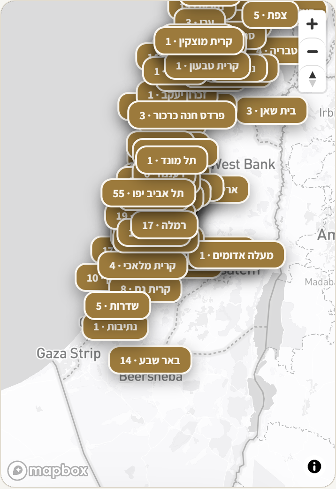 | 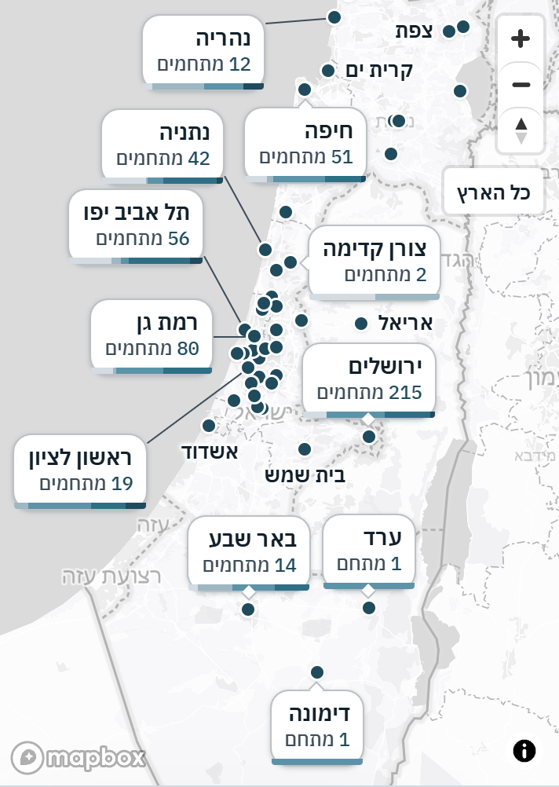 |
| phone, central | 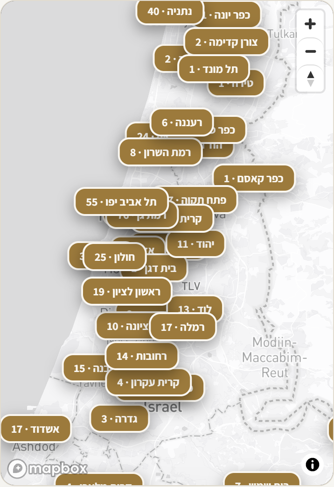 | 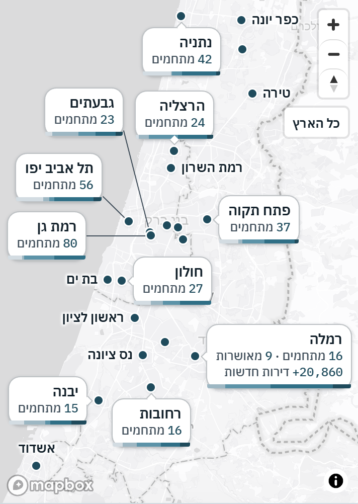 |
| phone, tlv | 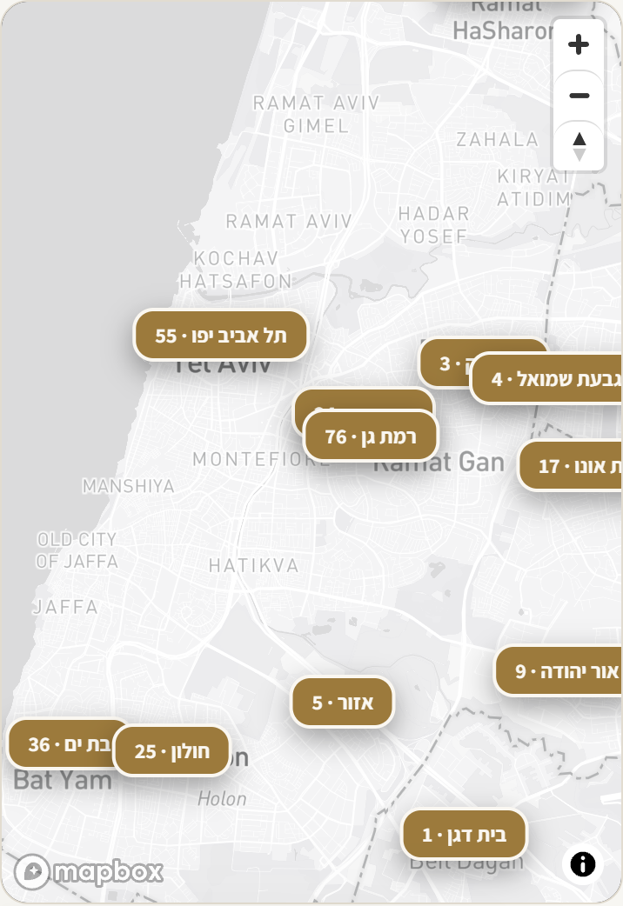 | 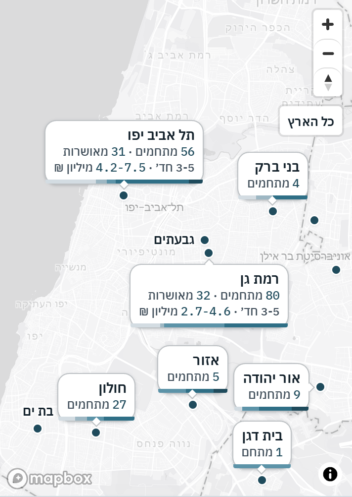 |
| desktop, country | 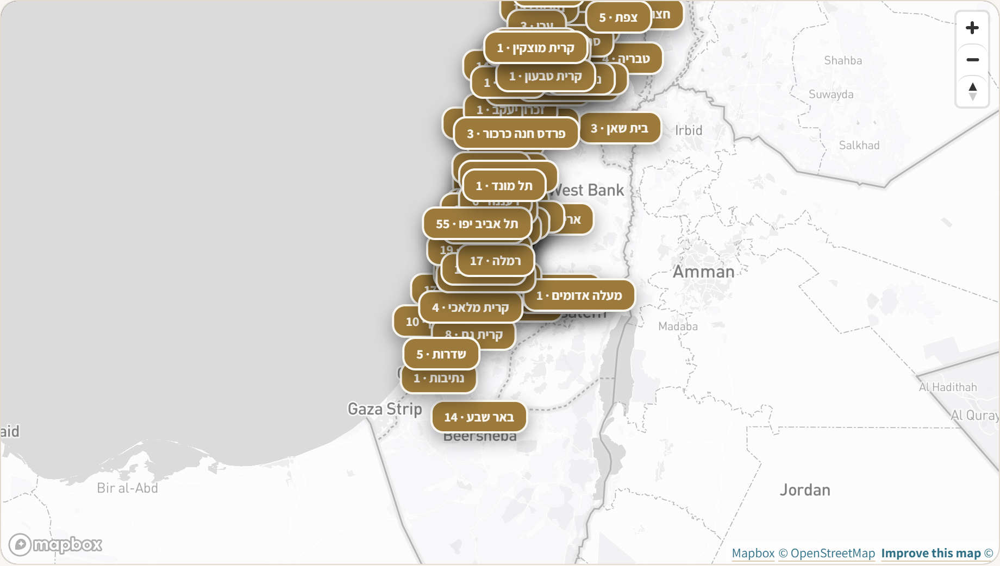 | 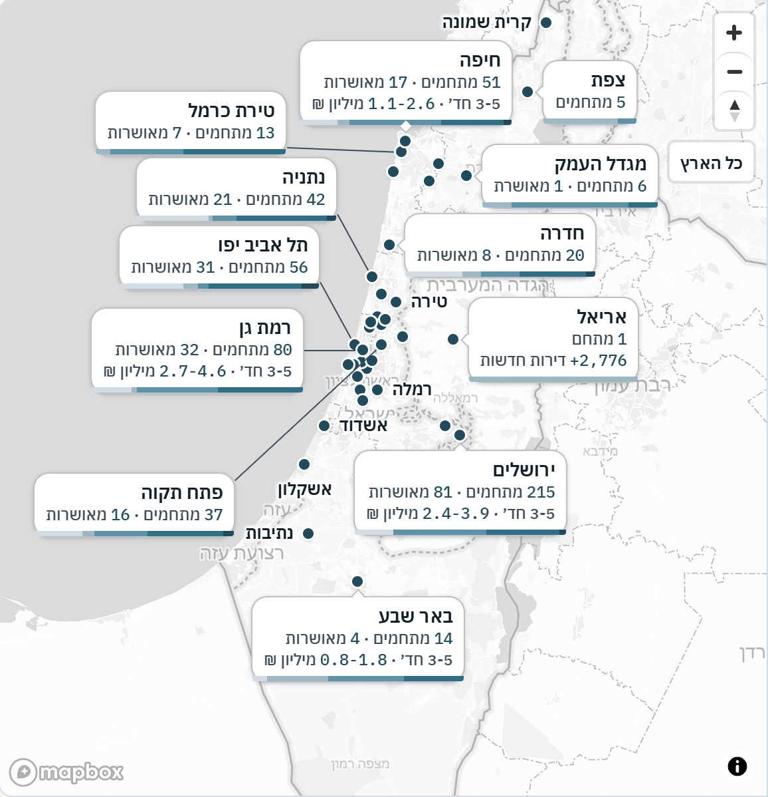 |
| desktop, central | 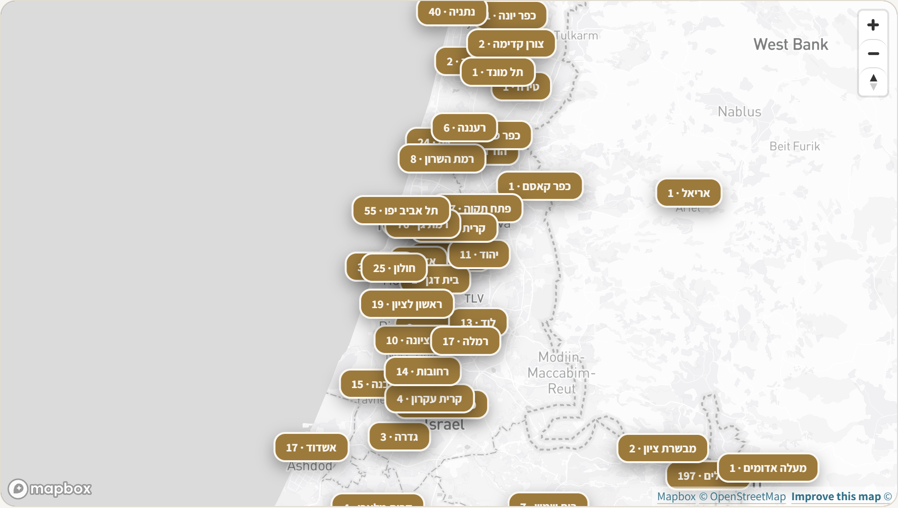 | 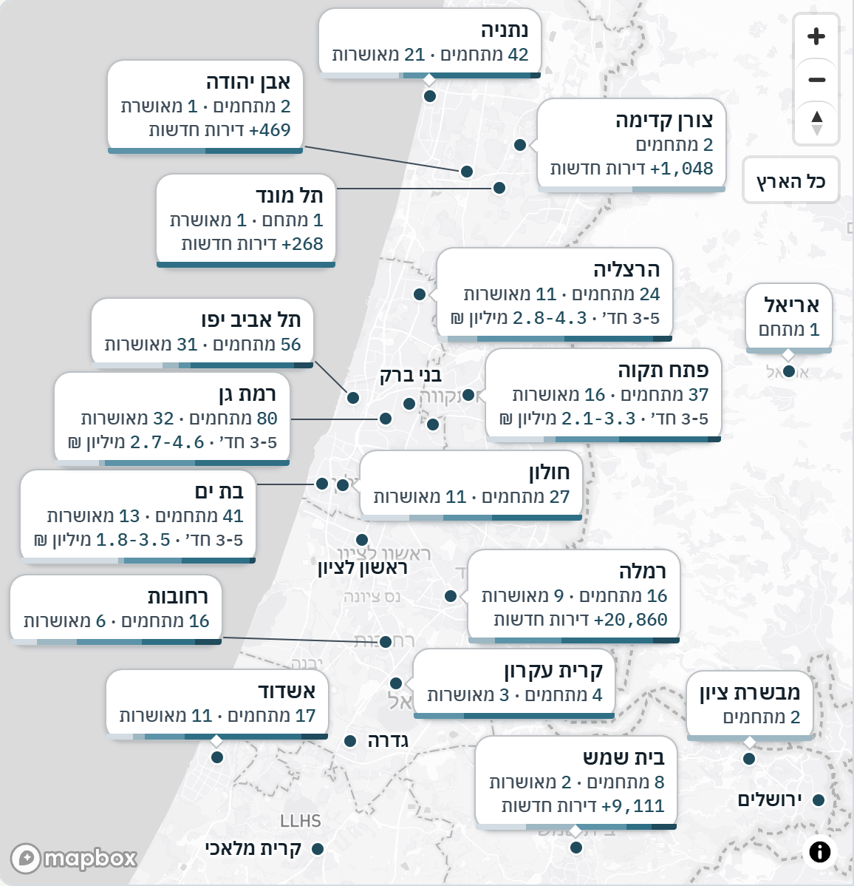 |
| desktop, tlv | 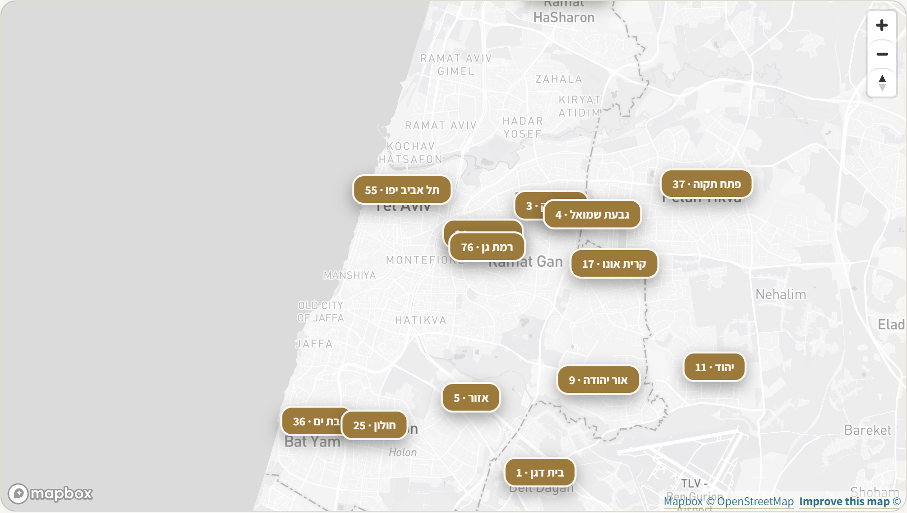 | 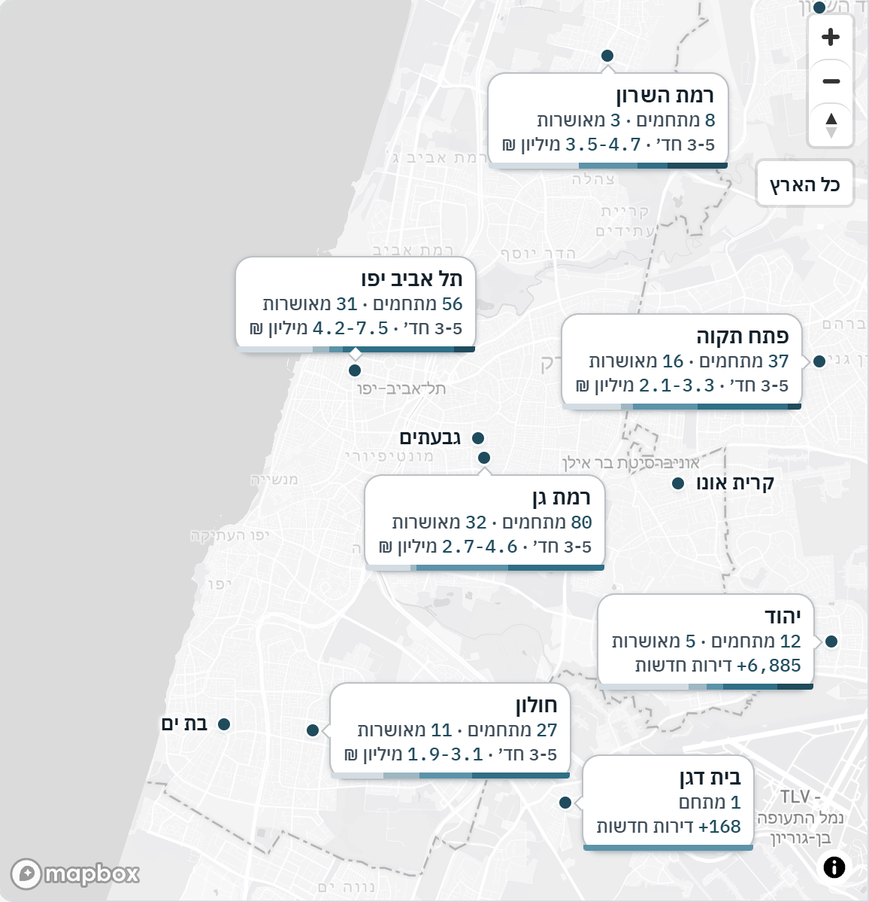 |

## Not verified

- Real phones (iOS Safari, Android Chrome) and real GPUs: desktop Chrome with phone emulation and software WebGL only.
- Two-finger pan and pinch on the map (cooperative gestures are unchanged, not exercised).
- Screen readers: tags are buttons with full Hebrew labels, the panel is a labelled region with a live line, the peek a dialog; no screen reader was run.
- The live text of `inc/urban-hub.php` (see HAD-605 above).
- Hotjar: blocked during the test on purpose; how existing heatmaps and recordings map onto the new layout was not checked.
- Madlan, Yad2, Zillow and Redfin blocked plain Chrome today (403, CAPTCHA); Madlan, Zillow and Redfin notes rest on this morning's captures, Yad2 has none.
- The coastline used to keep sea tags over water is coarse on purpose (the bay of Haifa counts as land); checked by eye on the screenshots, not against a coastline file.

## Files

| file | what |
|---|---|
| `urban-map-v2.patch.php.txt` | the patch against the live `inc/urban-map.php` (6 hunks: one centroid, the PHP function, the shortcode line, the note, the style, the script), NOT applied |
| `urban-hub-had605.patch.php.txt` | the HAD-605 fix for `inc/urban-hub.php` (6 hunks), NOT applied |
| `src/style.css.txt, src/script.js.txt, make_patch.py` | the sources of the patch and its assembler |
| `build2.py, lib2.py` | apply to a copy, php -l, round trip, drift check against the live page, node --check, preview.html |
| `serve2.py` | local preview: `python serve2.py`, then http://localhost:8766/live.html (the whole live page with the v2 block swapped in memory, analytics removed) |
| `proof2.py, timing2.py, had605_test.py, proof-results.json, out/` | the measurements and their raw results |
| `fetch_cache.py, cache/` | the public inputs, cached (the page with its map key redacted) |
| `bench/` | competitor captures, bench2.py, BENCH.md |
| `compare_phone.py, ds_build2.py` | the phone comparison image and the design board card |
